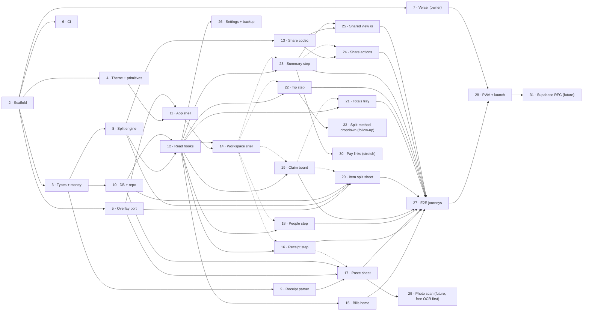

# split-it v1: implementation plan (parallel)

> **For agentic workers:** read the spec first:
> [`docs/superpowers/specs/2026-11-25-split-it-design.md`](../specs/2026-11-25-split-it-design.md).
> Every task is a GitHub issue under the tracking epic **#1**. Pick an issue whose **Blocked by**
> issues are all merged. Work on a branch named `issue-<n>-<slug>` and open one PR per issue.
> UI issues invoke the frontend-design skill before building screens.

**Goal:** ship split-it v1. It is a device-local, mobile-first bill splitter: enter or paste
an itemized receipt, claim items (including x-of-y partial splits and weighted shares), and
get per-person totals that reconcile to the cent. It deploys to Vercel from
`mzetinajimenez/split-it`.

**Architecture** (savor's): Next.js 16 App Router + Tailwind v4 tokens; Dexie (IndexedDB) as
the only state; reads through `lib/hooks.ts`, writes through `lib/repo.ts`; the pure,
heavily tested `lib/split.ts` derives every amount at render.

## Global constraints (apply to every issue)

- TypeScript strict; `@/*` → repo root.
- **No new dependencies without asking** (the same set as savor, minus maplibre).
- **Integer minor units only** for money; only `lib/money.ts` / `lib/split.ts` do money math.
- Components never import Dexie. The bill is one embedded document; bill rows are tombstoned.
- `Sheet` + `useModalA11y` for overlays, with `?sheet=` state (never `useState`, never an
  entity id in the URL).
- Tokens only (no raw hex in `app/`); `danger` = destructive/error only; `attention` = unclaimed.
- ≥ 44px targets, `md:hover:` only, safe-area insets, inputs ≥ 16px.
- **Green before merge:** `npm run lint`, `npm run typecheck`, `npm test`, `npm run build`,
  `npm run test:e2e` (CI #6 enforces this once it lands).
- Conventional-commit messages.

## Execution waves

A wave is the earliest point an issue can start once its hard blockers are merged. Issues in
the same wave touch disjoint files; the shared touch points are pre-agreed below.

| Wave | Issues | Notes |
|---|---|---|
| 1 | #2 scaffold | Root. Merge the planning-docs branch first. |
| 2 | #3 types+money · #4 theme · #5 overlay port · #6 CI · #7 Vercel *(owner)* | 5 in parallel |
| 3 | #8 split engine · #9 receipt parser · #10 db+repo · #11 app shell | 4 in parallel |
| 4 | #12 hooks · #13 share codec · #17 paste sheet · #20 item split sheet | #17 and #20 are components built against stub mounts |
| 5 | #14 workspace shell · #15 bills home · #16 receipt · #18 people · #19 claim board · #21 totals tray · #22 tip · #23 summary · #24 share actions · #26 settings | **10 in parallel.** Step screens own their own `page.tsx`; #14 is a soft dependency. |
| 6 | #25 shared view `/s` | needs #23's prop-driven components |
| 7 | #27 e2e journeys | fixtures can start once #19 lands |
| 8 | #28 PWA polish + launch | real-device checklist *(owner)* |
| Follow-up | #33 split-method dropdown: post-tax, fixed amount, equal (after #22) | the engine already supports every method |
| Stretch | #30 pay links (after #23) | |
| Future | #29 photo scan (**not in the MVP**; free on-device OCR first) · #31 Supabase live-claiming RFC | after v1 |

**Critical path:** #2 → #3 → #10 → #12 → (#19 / #23 …) → #25 → #27 → #28.

## Dependency graph

Solid arrows are hard blockers; dotted arrows are soft (mount points or layout, mergeable in
either order). Transitive edges are omitted.

## Pre-agreed shared touch points

These are the only places two issues edit the same file. Each is a one-line, mergeable change.

| File | Owner | Other issue's touch |
|---|---|---|
| `app/components/AppInit.tsx` | #11 | #12 adds the `useDbInit()` call |
| `app/bills/[id]/<step>/page.tsx` | the step's issue (#16, #18, #19, #22, #23) | #14 creates stubs **only** for steps not yet on `main` |
| `app/bills/[id]/receipt/page.tsx` | #16 | #17 adds the "Paste receipt" button / sheet host |
| `app/bills/[id]/split/page.tsx` | #19 | #20 `<ItemSplitSheetHost/>`, #21 `<TotalsTray/>` mount points |
| `app/bills/[id]/summary/page.tsx` | #23 | #24 `<ShareActions/>` footer, #30 `<PayLinks/>` |
| `BOTTOM_BAR_CLEARANCE` (from #11) | #11 | consumed by #5's Toaster, #14 StepNav, #21 tray |
| `lib/testing/billFactory.ts` (from #8) | #8 | imported by the #13 and #27 tests |
| `e2e/helpers/seed.ts` (from #10) | #10 | used by every wave-5 screen e2e test |

## Owner actions (only the repo owner can do these)

1. ~~Decide the open questions~~. Done: spec §12 records the decisions.
2. Merge the planning-docs branch `claude/optimistic-knuth-jvilij` into `main` (before or with
   #2).
3. #7: connect the Vercel project, so every PR gets preview deploys.
4. #6: enable branch protection on `main` requiring the CI checks.
5. #29 (future): sign off on the free-OCR evaluation before any build, and before any paid option.
6. #28: the real-device checklist on iPhone and Android.
